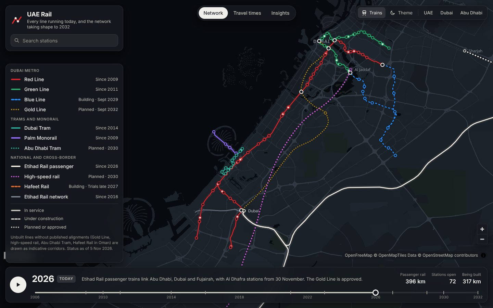
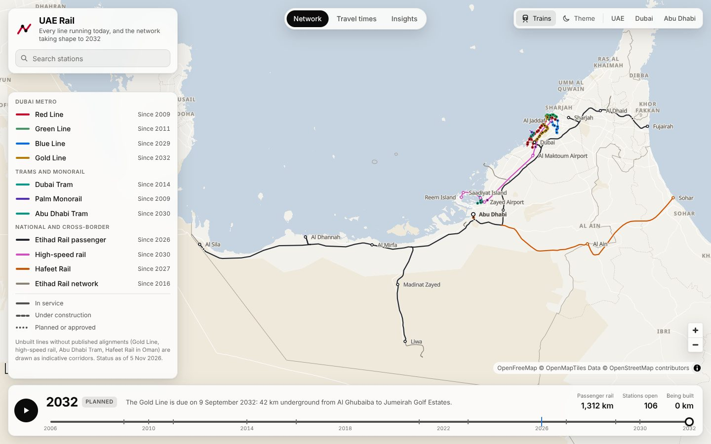
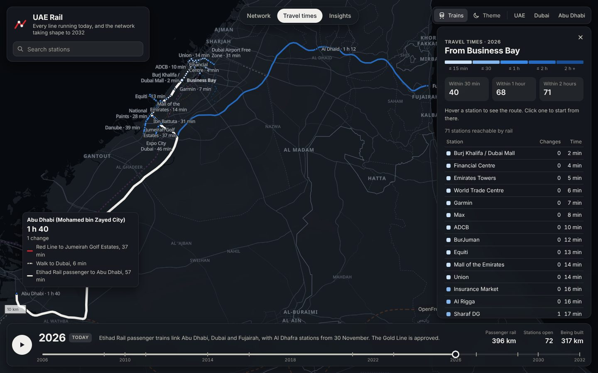
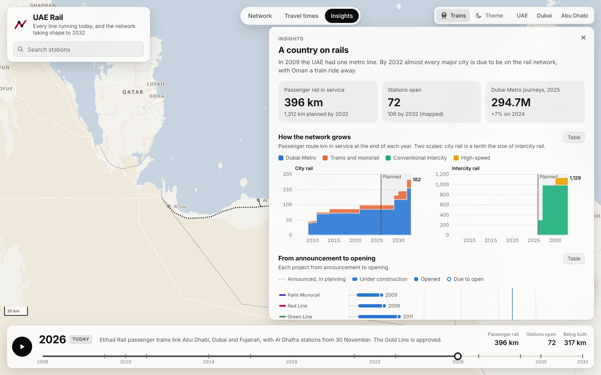

# UAE Rail Map

An interactive map of every rail line in the United Arab Emirates, from the first Dubai Metro trains in 2009 to the network planned for 2032: metro, trams, Etihad Rail's new passenger trains, the Abu Dhabi to Dubai high-speed line and Hafeet Rail to Oman.

**Live: <https://uae-rail-map.vercel.app>**



## What you can do

- **Scrub through time.** Drag the timeline from 2006 to 2032, or press play to watch the network grow. Lines change style as they move from planned (dots) to under construction (moving dashes) to in service (solid), and the headline numbers count up: route km in service, stations open, km being built.
- **Watch the trains.** Trains run on modelled timetables at 60 times real speed, slowing into stations and pausing at platforms. They only run on track that is open in the selected year.
- **See how far you can get.** In *Travel times*, pick any station to colour the network by journey time, hover a destination to trace the route with its changes, and move the timeline to see places come within reach as new lines open.
- **Follow a station's names.** Dubai Metro stations carry sponsor names that keep changing, so the map shows each station's name as it was in the selected year: drag back to 2015 and the Garmin station reads *Noor Bank*; in the year of a rename the label adds *(was ...)*. A station's card lists every name with its dates (select one to see the map as it was then), search finds a station by a name it used to have, and *Renamed stations* in the legend lists all 21 of them.
- **Read the numbers.** *Insights* charts the network's growth, every project from announcement to opening, Dubai Metro ridership since 2009, and rail against road for the big intercity trips. Two charts cover the station renames: how many happened each year (8 of the 32 were in 2020) and how long each name lasted. Every chart has a table view.
- Click any line or station for details (with Arabic names and sources), search stations by name, switch light and dark maps, and share a view: the URL keeps the year, view and selection (for example `#year=2030&view=explore&station=dm-business-bay`).

| | |
|---|---|
|  |  |
| The planned network in 2032 | Travel times from Business Bay in 2026 |



## What's on the map

Status as of 5 November 2026.

| Line | Status | Opening | Geometry |
|---|---|---|---|
| Dubai Metro Red Line | In service | 2009 (Route 2020 branch, 2021) | OpenStreetMap |
| Dubai Metro Green Line | In service | 2011 | OpenStreetMap |
| Dubai Metro Blue Line | Under construction, about 25% complete | 9 September 2029 | OpenStreetMap construction ways |
| Dubai Metro Gold Line | Approved April 2026 | 9 September 2032 | Indicative corridor |
| Dubai Tram | In service | 2014 | OpenStreetMap |
| Palm Monorail | In service | 2009 | OpenStreetMap |
| Abu Dhabi Tram (Line 4) | Approved | 2030 | Indicative corridor |
| Etihad Rail passenger | Opening in phases | From 30 June 2026 | Traced along OpenStreetMap track |
| Etihad Rail network (freight) | In service | 2016 (stage 1), 2023 (stage 2) | OpenStreetMap |
| Abu Dhabi to Dubai high-speed rail | Planned | By 2030 | Indicative corridor |
| Hafeet Rail (Abu Dhabi to Sohar) | Under construction, about 40% complete | Trial operations late 2027 | OpenStreetMap in the UAE, indicative in Oman |

Etihad Rail passenger stations: Abu Dhabi (Mohamed bin Zayed City) and Fujairah opened 30 June 2026, Dubai (Al Yalayis) and Al Dhaid on 30 September 2026. Madinat Zayed and Mezaira'a are scheduled for 30 November 2026, Al Mirfa, Al Dhannah and Al Sila for 30 December 2026, and Sharjah (University City) for 30 March 2027. Al Faya has no announced date.

## Run it

It is a static site with no build step. Clone the repository and start a web server **from inside the project folder** (opening `index.html` as a file will not work, because the page loads its data with `fetch`):

```bash
git clone https://github.com/aljisri/uae-rail-map.git
```

```bash
cd uae-rail-map
```

```bash
python3 -m http.server 8000 --bind 127.0.0.1
```

Then open <http://localhost:8000>. Run the server inside the project folder, or it will list whatever folder you are in instead. `--bind 127.0.0.1` keeps it private to your computer: without it, Python serves that folder to everyone on your network.

To publish it with GitHub Pages, go to the repository's **Settings → Pages**, choose **Deploy from a branch**, and pick the branch and the `/ (root)` folder.

## How it works

- **Map:** [MapLibre GL JS](https://maplibre.org/) 4.7 with a custom, deliberately quiet basemap on [OpenFreeMap](https://openfreemap.org/) vector tiles (no API key). If the tile server cannot be reached, a coarse Natural Earth coastline is drawn instead so the network never floats on a blank background.
- **Charts:** [D3](https://d3js.org/) 7.9.
- **Data:** `data/network.json` holds every line as dated track segments, every station with per-line opening dates, a journey-time graph, and train services for the animation. It is built from OpenStreetMap plus the curated facts in `scripts/config.py`, where each line lists its sources.
- **Station names:** `NAME_HISTORY` in `scripts/config.py` lists each renamed station's names with the date each took effect and the sources it came from; the build checks the order and dates and stores them on the station. The map, cards, search and charts all read the name that was in force on the selected date.
- **Journey times:** in-vehicle time is spread along the track in proportion to distance and scaled to published end-to-end times (for example Centrepoint to Expo City 74 minutes, Abu Dhabi to Dubai 57, Abu Dhabi to Fujairah 105, Creek to Academic City 25). Changing trains costs 4 minutes, nearby stations are linked by short walks (Jumeirah Golf Estates metro to Etihad Rail's Al Yalayis station is 6 minutes over the footbridge), and western and eastern Etihad Rail services count as separate trains that meet in Abu Dhabi. Waiting for the first train is not included.
- **Colour:** line colours keep their familiar hues, but their lightness and saturation were tuned with a palette validator so that lines that share stations stay distinguishable with red-green colour blindness (CVD ΔE ≥ 8, for example Red and Green lines at 9.2 on the dark map) and keep at least 3:1 contrast on both basemaps. Status is never shown by colour alone: line style, line-name labels along the track, the legend and tooltips all carry it.
- **Code:** `js/network.js` (what exists on a date, routing), `js/layers.js` (map styling), `js/trains.js`, `js/timeline.js`, `js/explorer.js`, `js/charts.js`, `js/ui.js`, wired together in `js/main.js`.

### Rebuilding the data

The OpenStreetMap extracts are committed in `data/osm/`, so the network can be rebuilt offline:

```bash
pip install shapely pyproj
```

```bash
python3 scripts/build_network.py
```

To pull fresh OpenStreetMap data first (public Overpass servers are often busy, so the script retries across mirrors):

```bash
python3 scripts/fetch_osm.py
```

`python3 scripts/build_fallback.py` regenerates the fallback coastline.

## Accuracy notes

- **Indicative corridors.** The Gold Line, the high-speed line, the Abu Dhabi Tram and the Oman section of Hafeet Rail have no published alignments. They are drawn through the areas the announcements name, and only stations that have been confirmed are shown (for the Gold Line: Al Ghubaiba, BurJuman, Business Bay, Meydan and Jumeirah Golf Estates, out of 18).
- **Approximate stations.** Stations whose exact site is not published or mapped are flagged in their card. Etihad Rail's Al Dhafra stations sit on the track nearest the town they serve.
- **Station name dates** are kept to the precision the sources agree on. Wikipedia's two rename tables often differ by a day, so most renames show a month, and a few only a year. Some entries are judgement calls and say so on the station's card: the Insurance Market station is shown as Sharaf DG, then Mashreq (from 18 May 2020), then Insurance Market, because the Sharaf DG station page says so while another page lists the first two names the other way round; the Expo City Dubai and Palm Jumeirah Mall renames rest on Wikipedia alone. Only Dubai Metro and the Palm Monorail were researched, so the Tram and Etihad Rail have no name history. Names of the early planning stage are not tracked, except where a source gives one.
- **Planned dates** are the ones announced and may move. Opening years shown without a day (2027, 2030) mean "during that year".
- **Freight network** geometry follows OpenStreetMap, where some sections are mapped as two parallel tracks, so its drawn length (about 1,270 km) is longer than the official 900 km route. The headline numbers and charts count passenger lines only.

## Sources

- Dubai Metro, Red, Green, Blue and Gold lines, Dubai Tram, Palm Monorail: Wikipedia articles (station opening dates, lengths, ridership) and RTA announcements as reported by [The National](https://www.thenationalnews.com/news/uae/2026/04/22/dubai-unveils-9bn-metro-gold-line-linking-city-centre-to-suburbs/), [Khaleej Times](https://www.khaleejtimes.com/uae/dubai-metro-gold-line-route-map-18-stations-new-interchanges-etihad-rail-link) and [AGBI](https://www.agbi.com/infrastructure/2026/05/tunnelling-work-begins-on-the-dubai-metro-blue-line/).
- Etihad Rail: [Wikipedia](https://en.wikipedia.org/wiki/Etihad_Rail), [Gulf News station timeline](https://gulfnews.com/uae/transport/etihad-rail-expansion-when-will-the-remaining-passenger-stations-open-1.500619139), [The National station list](https://www.thenationalnews.com/news/uae/2026/01/08/etihad-rail-reveals-more-passenger-stations-ahead-of-service-launch-this-year/), [What's On on Dubai's stations](https://whatson.ae/2026/09/dubai-is-getting-4-etihad-rail-stations-heres-where-theyll-be/).
- High-speed rail: [The National](https://www.thenationalnews.com/uae/transport/2025/01/24/etihad-rail-map-route-stations-abu-dhabi-dubai/).
- Hafeet Rail: [Khaleej Times](https://www.khaleejtimes.com/uae/hafeet-rail-uae-oman-work-stations-network), [Gulf News](https://gulfnews.com/world/gulf/oman/oman-uae-rail-link-to-begin-trial-operations-in-late-2027-1.500676388).
- Abu Dhabi Tram: [Wikipedia](https://en.wikipedia.org/wiki/Abu_Dhabi_Tram), [Gulf News](https://gulfnews.com/uae/abu-dhabi-tram-to-link-zayed-airport-with-yas-island-homes-1.500292263).
- Driving times: [OSRM](https://project-osrm.org/) free-flow estimates on OpenStreetMap data.

## Data licences

- Track and station geometry © [OpenStreetMap contributors](https://www.openstreetmap.org/copyright), available under the Open Database License (ODbL 1.0). `data/osm/` and `data/network.json` are derived databases and are shared under the same licence.
- Basemap: [OpenFreeMap](https://openfreemap.org/), [OpenMapTiles](https://openmaptiles.org/), OpenStreetMap.
- Fallback coastline: [Natural Earth](https://www.naturalearthdata.com/) (public domain).
